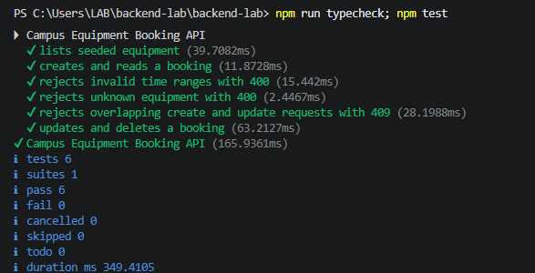
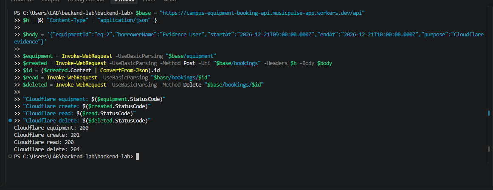
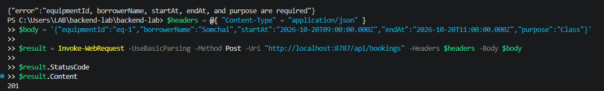

# Test Evidence

Base URL used for testing: `http://localhost:8787/api`

Cloudflare submission Base URL: `https://campus-equipment-booking-api.musicpulse-app.workers.dev/api`

Cloudflare live verification on 2026-10-06: equipment `200`; booking creation `201`.

Start the API in one terminal:

```powershell
npm start
```

Run these cases from another PowerShell terminal. The response bodies shown are representative; IDs are generated by SQLite and may differ between runs.

## Case 1: list equipment

```powershell
curl.exe http://localhost:8787/api/equipment
```

Expected: `200` and at least `eq-1` and `eq-2`.

## Case 2: create booking

```powershell
curl.exe -X POST http://localhost:8787/api/bookings -H "Content-Type: application/json" -d '{"equipmentId":"eq-1","borrowerName":"Somchai Jaidee","startAt":"2026-10-20T09:00:00.000Z","endAt":"2026-10-20T11:00:00.000Z","purpose":"Class presentation"}'
```

Expected: `201` and a booking containing all six required fields.

## Case 3: reject invalid time

```powershell
curl.exe -i -X POST http://localhost:8787/api/bookings -H "Content-Type: application/json" -d '{"equipmentId":"eq-1","borrowerName":"Somchai Jaidee","startAt":"2026-10-20T11:00:00.000Z","endAt":"2026-10-20T09:00:00.000Z","purpose":"Invalid test"}'
```

Expected: `400` and `{ "error": "startAt must be before endAt" }`.

## Case 4: reject overlapping booking

Repeat Case 2 with the same equipment and overlapping times.

Expected: `409` and `{ "error": "Booking time conflicts with an existing booking" }`.

## Case 5: update booking

```powershell
curl.exe -X PATCH http://localhost:8787/api/bookings/1 -H "Content-Type: application/json" -d '{"equipmentId":"eq-1","borrowerName":"Somchai Jaidee","startAt":"2026-10-20T11:00:00.000Z","endAt":"2026-10-20T12:00:00.000Z","purpose":"Updated presentation"}'
```

Expected: `200` and the updated booking.

## Case 6: delete and verify not found

```powershell
curl.exe -i -X DELETE http://localhost:8787/api/bookings/1
curl.exe -i http://localhost:8787/api/bookings/1
```

Expected: delete returns `204`; the subsequent read returns `404` with a JSON error.

## Automated verification

Command:

```powershell
npm test
```

Observed result on 2026-10-06: **6 tests passed, 0 failed**. The automated cases cover equipment listing, create/read, invalid time, unknown equipment, overlapping create/update, update/delete, and not-found behavior.

## Screenshot evidence

### Automated tests



### Live Cloudflare API Verification



### Create Booking Request (201 Created)

